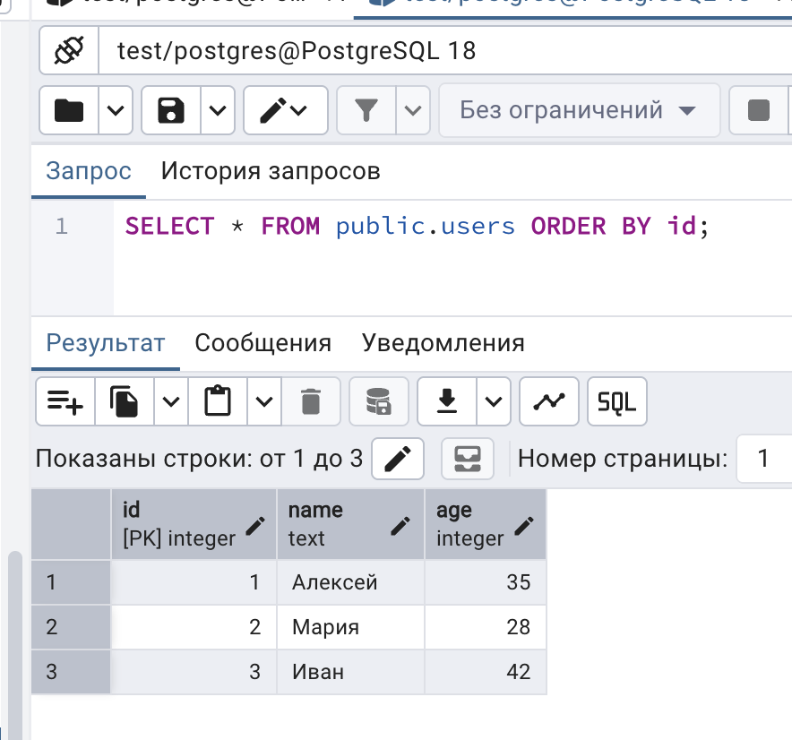
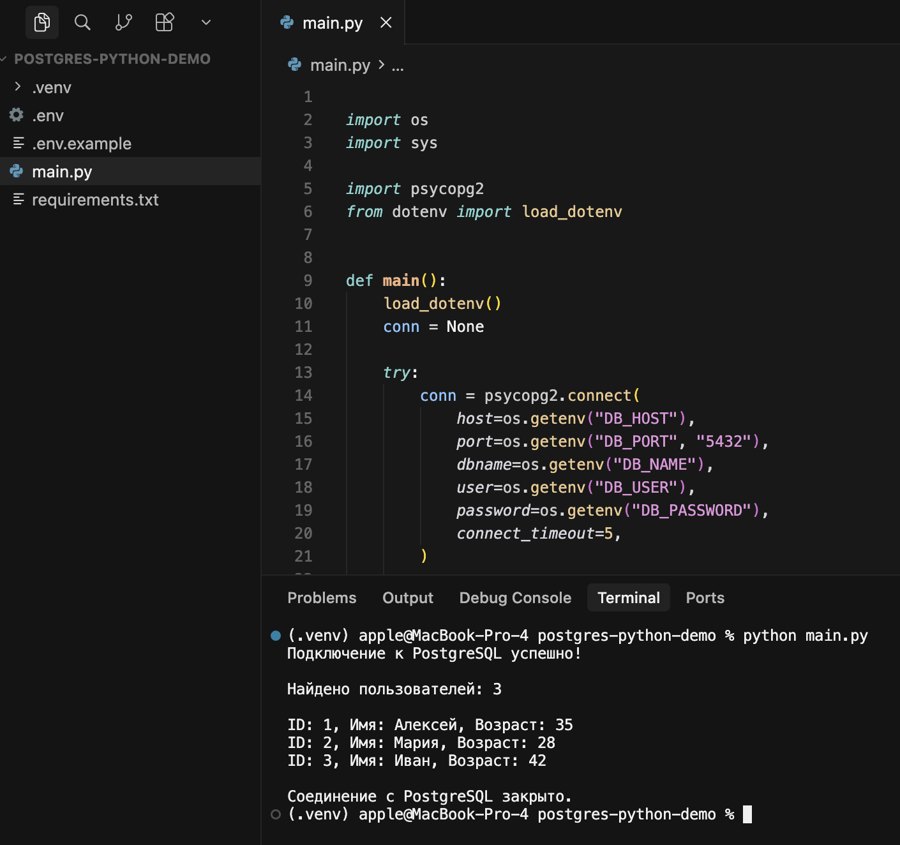

# PostgreSQL + Python (psycopg2)

Учебный проект подключения Python к PostgreSQL с использованием `psycopg2` и `python-dotenv`.

## Возможности

- Подключение к PostgreSQL через переменные окружения.
- Чтение пользователей из таблицы `public.users`.
- Вывод результатов SQL-запроса в терминал.
- Обработка ошибок подключения и выполнения запроса.
- Корректное закрытие соединения.

## Требования

- Python 3.10+
- PostgreSQL
- База данных `test` с таблицей `public.users`

## Подготовка базы данных

Создать базу данных `test` в pgAdmin.

В Query Tool выполнить:

```sql
CREATE TABLE IF NOT EXISTS public.users (
    id SERIAL PRIMARY KEY,
    name TEXT NOT NULL,
    age INT CHECK (age >= 0)
);
```

Добавить минимум три записи через View/Edit Data в pgAdmin.

## Установка

```bash
git clone <URL_репозитория>
cd postgres-python-demo
python3 -m venv .venv
source .venv/bin/activate
pip install -r requirements.txt
```

## Настройка

Создать файл `.env`:

```bash
cp .env.example .env
```

Указать параметры локальной базы данных и пароль PostgreSQL.

## Запуск

```bash
python main.py
```

Программа выводит список пользователей и закрывает соединение с PostgreSQL.

## Демонстрация работы

### Таблица пользователей в pgAdmin



### Результат запуска Python



## Безопасность

Пароль базы данных хранится в локальном `.env`, который исключён из Git.

## Стек

Python, PostgreSQL, psycopg2-binary, python-dotenv.

## Результат

Реализовано подключение к PostgreSQL из Python, чтение данных SQL-запросом и корректное закрытие соединения.